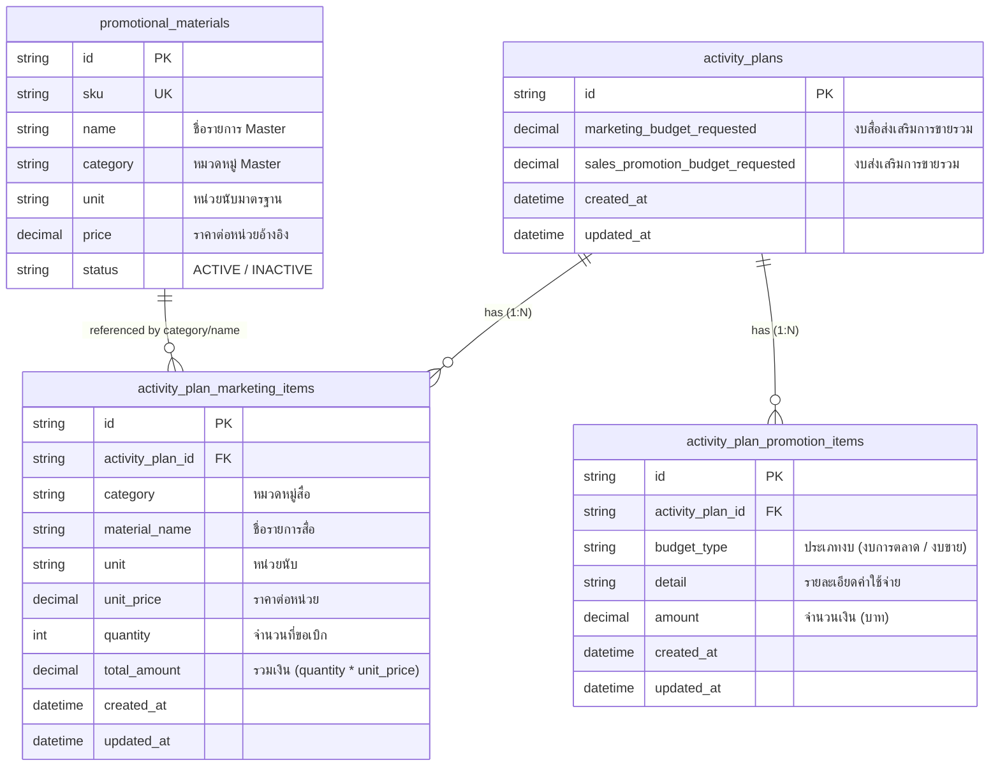

# Plan Budget Section — โมดูลงบประมาณและค่าใช้จ่าย (README)

> **Parent Slice**: `modules/activity/ui/budget`
> **Architecture**: Vertical Slice & Feature-based Sub-components
> **Authority Schema**: `activity_plan_marketing_items`, `activity_plan_promotion_items`

---

## 1. Overview & Structure

ส่วนแสดงผลและจัดการข้อมูล "งบประมาณและค่าใช้จ่าย" ภายในฟอร์มแผนงานและผลงานกิจกรรม (Activity Plan) ได้รับการจัดโครงสร้างแบบ Modular Clean Architecture แยกสัดส่วนความรับผิดชอบอย่างชัดเจน:

```text
modules/activity/ui/budget/
├── components/
│   ├── budget-checkbox-selector.tsx      # แถบ Checkbox เลือกว่าจะเปิดใช้ส่วนไหน (พร้อมเงื่อนไข TYPE_8, 9, 10, 12)
│   ├── promotional-media-card.tsx        # กล่องตาราง "สื่อส่งเสริมการขาย" + สรุปคำนวณ % สัดส่วนยอดขาย
│   ├── sales-promotion-card.tsx          # กล่องตาราง "รายการส่งเสริมการขาย" (งบจัดงาน/โปรโมชั่น)
│   └── index.ts
├── hooks/
│   ├── use-plan-budget.ts                # Main Orchestrator Hook (รวมศูนย์ State แบบ Backward-compatible)
│   ├── use-promotional-media.ts          # State & Handlers ของสื่อส่งเสริมการขาย
│   ├── use-sales-promotion.ts            # State & Handlers ของรายการส่งเสริมการขาย
│   └── index.ts
├── types.ts                              # Source of Truth สำหรับ Interfaces & Types
├── plan-budget-section.tsx               # Orchestrator Section (~80 บรรทัด)
├── index.ts                              # Public Export Barrel
└── README.md                             # Documentation
```

---

## 2. Business Rules & Behavior

### 2.1 สื่อส่งเสริมการขาย (Promotional Media / Marketing Items)
- **สิทธิ์การใช้งาน:** ทุกประเภทงาน (Type 1 – 14) สามารถขอเบิกสื่อได้
- **Master Data:** ดึงรายการและราคาอ้างอิงจากแคตตาล็อก Master Data (`PromotionalMaterial`) เช่น หมวด `Premium_item`, `PP_Board`, `Banner`, `Leaflet`, หรือ `อื่นๆ`
- **Financial Calculation:** 
  - คำนวณราคารวมของสื่อที่ขอเบิก (`quantity * unitPrice`)
  - คำนวณสัดส่วนต่องบยอดขาย (`targetSales` vs `marketingBudget` %) แสดงในการ์ดสถิติแบบ Real-time
- **Database Mapping:** บันทึกลงตาราง `activity_plan_marketing_items`

### 2.2 รายการส่งเสริมการขาย (Sales Promotion / Event Budget)
- **สิทธิ์การใช้งาน (Conditional Eligibility):** 
  - แสดงตัวเลือกให้ติ๊กเฉพาะเมื่อเลือกประเภทงาน:
    - **`TYPE_8`** (จัดประชุม)
    - **`TYPE_9`** (จัดกิจกรรมส่งเสริมการขายหน้าร้าน)
    - **`TYPE_10`** (จัดงาน Field Day)
    - **`TYPE_12`** (ทัวร์ / ดูงาน)
  - หากสลับประเภทงานไปเป็นประเภทอื่น ระบบจะ Uncheck โดยอัตโนมัติเพื่อป้องกันข้อมูลตกค้าง
- **Data Model:** ระบุรายละเอียดรายการ, จำนวนเงิน, และประเภทการใช้งบ (`งบการตลาด` หรือ `งบขาย`)
- **Database Mapping:** บันทึกลงตาราง `activity_plan_promotion_items`

---

## 3. ตารางเก็บข้อมูลในฐานข้อมูล (Database Schema & Storage Architecture)

การจัดเก็บข้อมูลงบประมาณในฐานข้อมูลแบ่งออกเป็น **Header Summary**, **ตารางเก็บรายการย่อย (Items Level)**, และ **ตาราง Master Data**:

### 3.1 Entity-Relationship Diagram (ERD)



---

### 3.2 รายละเอียดตารางและฟิลด์ (Data Dictionary)

#### 1) ตารางหลัก: `activity_plans` (ส่วนที่เกี่ยวข้องกับงบประมาณ)
เก็บยอดรวมคำนวณสรุป (Header Snapshot) เพื่อใช้ในหน้ารายการ การอนุมัติ และออกรายงานได้อย่างรวดเร็ว

| ฟิลด์ (Field) | ชนิดข้อมูล (Type) | Nullable | คำอธิบาย (Description) |
|---|---|:---:|---|
| `marketing_budget_requested` | `Decimal(15, 2)` | YES | ยอดรวมงบประมาณสื่อส่งเสริมการขายที่ขอเบิก (คำนวณจากผลรวม `activity_plan_marketing_items.total_amount`) |
| `sales_promotion_budget_requested` | `Decimal(15, 2)` | YES | ยอดรวมงบประมาณส่งเสริมการขายที่ขอเบิก (คำนวณจากผลรวม `activity_plan_promotion_items.amount`) |

---

#### 2) ตาราง: `activity_plan_marketing_items` (สื่อส่งเสริมการขาย)
บันทึกรายละเอียดวัสดุ อุปกรณ์ และสื่อประชาสัมพันธ์ที่ขอเบิกในแต่ละแผนงาน

> **Prisma Model**: `ActivityPlanMarketingItem` ([`schema.prisma`](file:///d:/code/crm-bank/prisma/schema.prisma#L1833-L1851))

| ฟิลด์ (Field) | ชนิดข้อมูล (Type) | Nullable | ค่าเริ่มต้น (Default) | คำอธิบาย (Description) |
|---|---|:---:|:---:|---|
| `id` | `String (cuid)` | NO | `cuid()` | Primary Key |
| `activity_plan_id` | `String` | NO | - | Foreign Key อ้างอิงไปยัง `activity_plans.id` (`ON DELETE CASCADE`) |
| `category` | `String` | NO | - | หมวดหมู่สื่อ (เช่น `Premium_item`, `PP_Board`, `Banner`, `Leaflet`, `อื่นๆ`) |
| `material_name` | `String` | NO | - | ชื่อรายการสื่อส่งเสริมการขาย (เช่น ป้ายไวนิลตราปืนใหญ่, เสื้อยืด, สมุดฉีก) |
| `unit` | `String` | YES | `"ชิ้น"` | หน่วยนับ (เช่น แผ่น, ผืน, ชิ้น, ใบ, เล่ม, ลัง) |
| `unit_price` | `Decimal(15, 2)` | NO | `0.00` | ราคาต่อหน่วย (ดึงราคามาตรฐานจาก Master หรือกำหนดเองกรณี "อื่นๆ") |
| `quantity` | `Int` | NO | `1` | จำนวนชุด/ชิ้นที่ขอเบิก |
| `total_amount` | `Decimal(15, 2)` | NO | `0.00` | ยอดเงินรวม = `quantity * unit_price` |
| `created_at` | `DateTime` | NO | `now()` | วันเวลาที่สร้างข้อมูล |
| `updated_at` | `DateTime` | NO | auto | วันเวลาที่อัปเดตข้อมูลล่าสุด |

**Indexes:**
- `@@index([activity_plan_id])`: ค้นหารายการสื่อตามรหัสแผนงาน
- `@@index([category])`: ค้นหาและจัดกลุ่มตามหมวดหมู่สื่อ

---

#### 3) ตาราง: `activity_plan_promotion_items` (รายการส่งเสริมการขาย)
บันทึกรายการขอสนับสนุนงบประมาณจัดกิจกรรมภาคสนาม สำหรับ `TYPE_8`, `TYPE_9`, `TYPE_10`, `TYPE_12`

> **Prisma Model**: `ActivityPlanPromotionItem` ([`schema.prisma`](file:///d:/code/crm-bank/prisma/schema.prisma#L1853-L1868))

| ฟิลด์ (Field) | ชนิดข้อมูล (Type) | Nullable | ค่าเริ่มต้น (Default) | คำอธิบาย (Description) |
|---|---|:---:|:---:|---|
| `id` | `String (cuid)` | NO | `cuid()` | Primary Key |
| `activity_plan_id` | `String` | NO | - | Foreign Key อ้างอิงไปยัง `activity_plans.id` (`ON DELETE CASCADE`) |
| `budget_type` | `String` | NO | `"งบการตลาด"` | ประเภทการใช้งบ (`"งบการตลาด"` หรือ `"งบขาย"`) |
| `detail` | `String` | NO | - | รายละเอียดค่าใช้จ่าย (เช่น ค่าอาหารผู้เข้าร่วมประชุม, รางวัลเกษตรกร) |
| `amount` | `Decimal(15, 2)` | NO | `0.00` | จำนวนเงินงบประมาณที่ขอใช้ (บาท) |
| `created_at` | `DateTime` | NO | `now()` | วันเวลาที่สร้างข้อมูล |
| `updated_at` | `DateTime` | NO | auto | วันเวลาที่อัปเดตข้อมูลล่าสุด |

**Indexes:**
- `@@index([activity_plan_id])`: ค้นหารายการงบตามรหัสแผนงาน
- `@@index([budget_type])`: ค้นหาและกรองตามประเภทการใช้งบ

---

#### 4) ตารางแคตตาล็อก: `promotional_materials` (Master Data)
ตารางหลักสำหรับจัดการสินค้า/สื่อประชาสัมพันธ์กลางขององค์กร

> **Prisma Model**: `PromotionalMaterial` ([`schema.prisma`](file:///d:/code/crm-bank/prisma/schema.prisma#L2255-L2275))

| ฟิลด์ (Field) | ชนิดข้อมูล (Type) | Nullable | คำอธิบาย (Description) |
|---|---|:---:|---|
| `id` | `String (cuid)` | NO | Primary Key |
| `sku` | `String` | NO | รหัส SKU สินค้า (Unique) |
| `name` | `String` | NO | ชื่อสื่อส่งเสริมการขาย |
| `category` | `String` | NO | หมวดหมู่สื่อ |
| `unit` | `String` | YES | หน่วยนับมาตรฐาน |
| `price` | `Decimal(15, 2)` | YES | ราคาต่อหน่วยมาตรฐาน |
| `status` | `PromotionalMaterialStatus` | NO | สถานะการใช้งาน (`ACTIVE` / `INACTIVE`) |
| `deleted_at` | `DateTime` | YES | วันเวลาที่ลบ (Soft Delete) |

---

## 4. Public API & Usage

```tsx
import { PlanBudgetSection, usePlanBudget } from "@/modules/activity/ui";

function MyActivityForm() {
  const budget = usePlanBudget({ initial: planData });

  return (
    <PlanBudgetSection
      selectedWorkTypes={selectedWorkTypes}
      readonly={false}
      isPromotionalMediaSelected={budget.isPromotionalMediaSelected}
      setIsPromotionalMediaSelected={budget.setIsPromotionalMediaSelected}
      isSalesPromotionSelected={budget.isSalesPromotionSelected}
      setIsSalesPromotionSelected={budget.setIsSalesPromotionSelected}
      marketingProductItems={budget.marketingProductItems}
      marketingBudgetAmount={budget.marketingBudgetAmount}
      addMarketingProductItem={budget.addMarketingProductItem}
      updateMarketingProductItem={budget.updateMarketingProductItem}
      deleteMarketingProductItem={budget.deleteMarketingProductItem}
      salesPromotionItems={budget.salesPromotionItems}
      addSalesPromotionRow={budget.addSalesPromotionRow}
      updateSalesPromotionRow={budget.updateSalesPromotionRow}
      deleteSalesPromotionRow={budget.deleteSalesPromotionRow}
      targetSales={targetSales}
      promotionalMaterialsByCategory={promotionalMaterialsByCategory}
    />
  );
}
```
