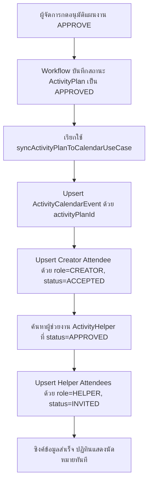
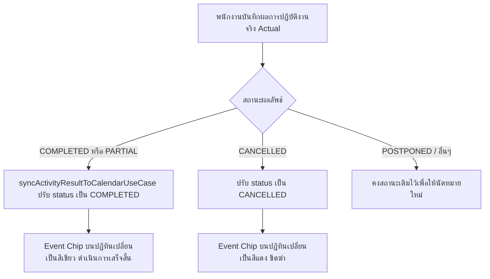

# Activity Calendar — ปฏิทินกิจกรรม (README)

> **View Orchestrator**: `modules/activity/views/calendar`
> **Route URL**: `/activity-plans/calendar`
> **Parent Module**: `modules/activity`
> **Database Authority**: `prisma/schema.prisma` (`ActivityCalendarEvent`, `ActivityCalendarAttendee`)
> **Status**: Production Ready / Clean Modular Architecture

---

## 1. Overview

### 1.1 วัตถุประสงค์ของ Activity Calendar
**Activity Calendar (ปฏิทินกิจกรรม)** เป็นศูนย์รวมแสดงตารางนัดหมายและการลงพื้นที่ปฏิบัติงานของพนักงานสนามทั้งหมด (ทั้งกิจกรรมตามแผนงานและกิจกรรมนอกแผน) โดยมีวัตถุประสงค์หลักเพื่อ:
1. ให้พนักงานสามารถตรวจสอบตารางนัดหมาย วันเวลา และสถานที่ปฏิบัติงานของตนเองได้อย่างรวดเร็วในรูปแบบปฏิทินรายเดือน
2. รองรับการทำงานร่วมกันของทีม โดยสามารถตรวจสอบกิจกรรมที่ตนเองได้รับมอบหมายเป็น **ผู้ช่วยงาน (Helper)** ร่วมกับผู้สร้างแผนหลัก (Creator)
3. ให้หัวหน้างานและผู้บริหารสามารถมองเห็นภาพรวมการกระจายตัวของกิจกรรมลงพื้นที่ในแต่ละวันของทีมงาน เพื่อป้องกันการนัดหมายซ้อนทับหรือวางแผนกำลังพลได้อย่างมีประสิทธิภาพ

### 1.2 ขอบเขตการทำงาน (Scope)
- **ประเภทกิจกรรมที่รองรับ:**
  - **กิจกรรมตามแผน (PLANNED):** แผนงานที่ผ่านการพิจารณาอนุมัติจากผู้จัดการ (Status: `APPROVED`) จะถูกซิงค์เข้าสู่ปฏิทินโดยอัตโนมัติ
  - **กิจกรรมนอกแผน (UNPLANNED 2-in-1):** กิจกรรมนอกแผนที่บันทึกผลเสร็จสิ้นทันที
- **มุมมองตัวกรอง (Filtering System):**
  - **Filter Tabs:**
    - `ALL` (ทั้งหมด): แสดงทุกกิจกรรมที่มีสิทธิ์เข้าถึง
    - `MY_EVENTS` (กิจกรรมหลัก): แสดงเฉพาะกิจกรรมที่ผู้ใช้เป็นผู้สร้างแผนงานหลัก
    - `HELPER_EVENTS` (กิจกรรมที่เป็นผู้ช่วย): แสดงกิจกรรมที่ผู้ใช้มีชื่อเป็นผู้ช่วยงานที่ได้รับอนุมัติ
  - **Multi-select & Keyword Search:**
    - ค้นหาด้วยคำสำคัญ (ชื่อกิจกรรม, รหัสแผนงาน, สถานที่)
    - กรองตามประเภทงาน (Work Types 1 - 14)
    - กรองตามรายชื่อบุคคล (ผู้สร้าง / ผู้ช่วยงาน)
    - กรองตามสถานะกิจกรรม (SCHEDULED, COMPLETED, CANCELLED)
- **การแสดงผลแบบ Mobile-First:**
  - รองรับการแสดงผลทั้งบน Desktop (แสดงชื่อและเวลาของแต่ละ Event ในช่องวัน) และบน Smart Mobile Device (แสดง Badge ตัวเลขจำนวนกิจกรรม พร้อม Modal รายการกิจกรรมรายวันเมื่อกดแตะ)

### 1.3 ระบบสิทธิ์การเข้าถึงข้อมูล (RBAC & Access Control)
การดึงข้อมูลจาก Server (`listActivityCalendarEventsUseCase`) จะตรวจสอบขอบเขตสิทธิ์ของผู้ใช้งาน:
1. **VIEW_ALL (ระดับผู้บริหาร/Admin):** มองเห็นปฏิทินกิจกรรมของพนักงานทุกสาขาและทุกแผนก
2. **VIEW_TEAM (ระดับผู้จัดการ/หัวหน้าทีม):** มองเห็นกิจกรรมของตนเองและสมาชิกในทีมทุกคน
3. **VIEW_OWN (ระดับพนักงานทั่วไป):** มองเห็นเฉพาะกิจกรรมที่ตนเองเป็นผู้สร้าง หรือได้รับมอบหมายเป็นผู้ช่วยงาน (Approved Helper)

---

## 2. Business & Synchronization Flows

### 2.1 Flow การซิงค์แผนงานเข้าสู่ปฏิทินเมื่อได้รับการอนุมัติ
เมื่อแผนงานผ่านขั้นตอนพิจารณาอนุมัติ (Approval Workflow) ระบบจะเรียกใช้งาน `syncActivityPlanToCalendarUseCase` เพื่อสร้างหรืออัปเดต Event ลงในฐานข้อมูลปฏิทินแบบ Atomic Transaction:



### 2.2 Flow การปรับปรุงสถานะเมื่อบันทึกผลงานจริง (Actual Outcome)
เมื่อพนักงานลงพื้นที่จริงและทำการบันทึกผลการปฏิบัติงาน:



### 2.3 Flow การยกเลิกแผนงาน (Plan Cancellation)
หากแผนงานถูกขอยกเลิกและผ่านการอนุมัติยกเลิก หรือถูก Reject:
- ระบบจะเรียก `cancelActivityPlanCalendarUseCase(activityPlanId, tx)`
- ปรับสถานะ `ActivityCalendarEvent.status` เป็น `CANCELLED`
- บนหน้าปฏิทินยังคงเห็นประวัติเดิม แต่แสดงตัวหนังสือขีดฆ่าและแถบสีแดงเพื่อความโปร่งใสของประวัติการทำงาน

---

## 3. Architecture & File Breakdown

ระบบปฏิทินได้รับการออกแบบตามโครงสร้าง **Vertical Slice & Modular Architecture** ขจัดปัญหา Monolithic File Bloat โดยแบ่งหน้าที่ออกเป็นชั้น ๆ อย่างชัดเจน:

```text
modules/activity/
├── infrastructure/
│   └── calendar-integration.ts           # Database Use Cases (sync, cancel, list events)
├── server/
│   ├── calendar.actions.ts               # Server Action: getActivityCalendarEventsAction
│   ├── planned.actions.ts                # Re-export calendar action (Backward Compatibility)
│   └── index.ts                          # Public Barrel สำหรับ Server Actions
│
└── views/calendar/
    ├── README.md                         # เอกสารคู่มือทางเทคนิค (ไฟล์นี้)
    ├── index.ts                          # Public Contract Barrel ของ views/calendar
    ├── activity-calendar-view.tsx        # Orchestrator Component (< 100 บรรทัด)
    ├── types/
    │   ├── calendar.types.ts             # Interface และ Types ทั้งหมดของปฏิทิน
    │   └── index.ts                      # Barrel export types
    ├── hooks/
    │   ├── use-activity-calendar.ts      # State วันที่, โหลดข้อมูล Event, กรองข้อมูล
    │   ├── use-calendar-filters.ts       # State ตัวกรอง (Search, MultiSelects, Tabs)
    │   └── index.ts                      # Barrel export hooks
    └── components/
        ├── calendar-header.tsx           # ส่วนหัว, ปุ่ม Back, ตัวเลื่อนเดือน, ปุ่ม "วันนี้"
        ├── calendar-filter-bar.tsx       # Filter Tabs, ช่องค้นหา, Dropdowns Multi-select
        ├── calendar-day-cell.tsx         # ช่องแต่ละวันในตาราง + Event Chips
        ├── calendar-grid.tsx             # ตาราง 7 วัน (วันอาทิตย์ - เสาร์)
        ├── calendar-event-modal.tsx      # Modal แสดงรายละเอียดนัดหมายและผู้ช่วยงาน
        ├── calendar-day-events-modal.tsx # Modal ลิสต์กิจกรรมประจำวันสำหรับมือถือ
        └── index.ts                      # Barrel export components
```

### 3.1 Responsibility Matrix (หน้าที่ของแต่ละส่วน)

| ส่วนประกอบ | ไฟล์ | หน้าที่และความรับผิดชอบ |
| :--- | :--- | :--- |
| **Orchestrator** | `activity-calendar-view.tsx` | ผสาน Hooks และ Components เข้าด้วยกัน จัดวาง Layout หลัก |
| **Data Fetch Hook** | `use-activity-calendar.ts` | คุม `currentDate`, ดึงข้อมูลจาก API, คำนวณช่วงวัน `date-fns`, คุม Modal Selection |
| **Filter Hook** | `use-calendar-filters.ts` | โหลดตัวเลือกพนักงาน/ประเภทงาน, จัดการ State ตัวกรองและคำค้นหา |
| **Header UI** | `calendar-header.tsx` | นำทางย้อนกลับ, เลื่อนเปลี่ยนเดือน, แสดงชื่อเดือนภาษาไทย, ปุ่มกลับมาวันปัจจุบัน |
| **Filter UI** | `calendar-filter-bar.tsx` | แท็บแยกบทบาท, ช่อง Search, ตัวกรองหลายเงื่อนไข, ปุ่มล้างตัวกรอง |
| **Grid UI** | `calendar-grid.tsx` | โครงสร้างตารางรายสัปดาห์ 7 วัน และ Render วันที่ |
| **Cell UI** | `calendar-day-cell.tsx` | แสดงวันที่ปัจจุบัน, แสดงชิปกองกิจกรรมสูงสุด 3 รายการพร้อมสีตามสถานะ |
| **Event Modal** | `calendar-event-modal.tsx` | แสดงข้อมูลเจาะลึก: เวลา, สถานที่, ผู้สร้าง, รายชื่อผู้ช่วยงาน, ลิงก์ไปแผนงาน |
| **Day Modal** | `calendar-day-events-modal.tsx` | แสดงรายการกิจกรรมทั้งหมดในวันที่กดแตะ (กรณีมีหลายกิจกรรมในวันเดียว) |
| **Server Action** | `server/calendar.actions.ts` | เป็น Gatekeeper รับ Request จาก Client, Serialize ข้อมูล, คืนค่า Response |
| **DB Service** | `calendar-integration.ts` | ติดต่อฐานข้อมูลผ่าน Prisma Transactions (`upsert`, `findMany`) |

---

## 4. Database Integration & Schema

### 4.1 Schema Definition (`prisma/schema.prisma`)

```prisma
model ActivityCalendarEvent {
  id             String              @id @default(cuid())
  activityPlanId String              @unique @map("activity_plan_id")
  title          String
  description    String?
  location       String?
  province       String?
  district       String?
  startDate      DateTime            @map("start_date")
  endDate        DateTime            @map("end_date")
  status         CalendarEventStatus @default(SCHEDULED)

  createdById String @map("created_by_id")
  employeeId  String @map("employee_id")

  createdAt DateTime  @default(now()) @map("created_at")
  updatedAt DateTime  @updatedAt @map("updated_at")
  deletedAt DateTime? @map("deleted_at")

  activityPlan ActivityPlan               @relation(fields: [activityPlanId], references: [id], onDelete: Cascade)
  createdBy    User                       @relation("UserCreatedCalendarEvents", fields: [createdById], references: [id], onDelete: Restrict)
  employee     Employee                   @relation("EmployeeCreatedCalendarEvents", fields: [employeeId], references: [id], onDelete: Restrict)
  attendees    ActivityCalendarAttendee[]

  @@index([employeeId])
  @@index([startDate])
  @@map("activity_calendar_events")
}

model ActivityCalendarAttendee {
  id              String                 @id @default(cuid())
  calendarEventId String                 @map("calendar_event_id")
  employeeId      String                 @map("employee_id")
  role            CalendarAttendeeRole   @default(HELPER)
  status          CalendarAttendeeStatus @default(INVITED)

  createdAt DateTime @default(now()) @map("created_at")
  updatedAt DateTime @updatedAt @map("updated_at")

  calendarEvent ActivityCalendarEvent @relation(fields: [calendarEventId], references: [id], onDelete: Cascade)
  employee      Employee              @relation("EmployeeCalendarAttendees", fields: [employeeId], references: [id], onDelete: Restrict)

  @@unique([calendarEventId, employeeId])
  @@index([employeeId])
  @@index([status])
  @@map("activity_calendar_attendees")
}
```

### 4.2 Status Enums
- **`CalendarEventStatus`**:
  - `SCHEDULED`: มีนัดหมายตามกำหนดการ (สีน้ำเงิน)
  - `COMPLETED`: กิจกรรมเสร็จสิ้นแล้ว (สีเขียว)
  - `CANCELLED`: กิจกรรมถูกยกเลิก (สีแดง ขีดฆ่า)
- **`CalendarAttendeeRole`**:
  - `CREATOR`: ผู้สร้างแผนงานหลัก
  - `HELPER`: ผู้ช่วยงานที่ได้รับอนุมัติร่วมเดินทาง

---

## 5. Hook & Component API Contract

### 5.1 `useCalendarFilters()`
```typescript
interface CalendarFilterState {
  filter: "ALL" | "MY_EVENTS" | "HELPER_EVENTS";
  setFilter: (f: CalendarFilter) => void;
  workTypeFilters: string[];
  setWorkTypeFilters: (v: string[]) => void;
  personFilters: string[];
  setPersonFilters: (v: string[]) => void;
  statusFilters: string[];
  setStatusFilters: (v: string[]) => void;
  searchKeyword: string;
  setSearchKeyword: (v: string) => void;
  workTypeOptions: MultiSelectOption[];
  personOptions: MultiSelectOption[];
  hasActiveFilters: boolean;
  handleClearAllFilters: () => void;
  syncAttendeeOptions: (events: CalendarEvent[]) => void;
}
```

### 5.2 `useActivityCalendar(filterState)`
```typescript
interface UseActivityCalendarReturn {
  currentDate: Date;
  setCurrentDate: (d: Date) => void;
  events: CalendarEvent[];
  filteredEvents: CalendarEvent[];
  loading: boolean;
  calendarDays: Date[];
  getEventsForDay: (day: Date) => CalendarEvent[];
  selectedEvent: CalendarEvent | null;
  setSelectedEvent: (e: CalendarEvent | null) => void;
  selectedDayEvents: DayEventsSelection | null;
  setSelectedDayEvents: (s: DayEventsSelection | null) => void;
  fetchEvents: () => Promise<void>;
}
```

---

## 6. Best Practices & Do's / Don'ts

### ✅ Do's (สิ่งที่ควรปฏิบัติ)
1. **รักษา Client/Server Boundary อย่างเคร่งครัด**: คอมโพเนนต์ UI ใน `views/calendar/` ต้องระบุ `"use client"` และเรียกข้อมูลผ่าน Server Actions ใน `@/modules/activity/server` เท่านั้น **ห้าม** เรียกใช้ `db` (Prisma) ตรงจาก UI เด็ดขาด
2. **ใช้ Public Barrels เสมอ**: การนำเข้าจากภายนอกโมดูล ต้อง import ผ่าน `@/modules/activity` หรือ `@/modules/activity/views` เท่านั้น ห้าม Deep Import เข้าไปยัง `views/calendar/components/...`
3. **รักษา Mobile Responsiveness**: การออกแบบหน้าจอต้องใช้คลาส Tailwind แบบ Mobile-First เริ่มต้นที่จอขนาดเล็ก แล้วขยายความกว้างด้วย `sm:`, `md:`, `lg:`
4. **ความแม่นยำของ Timezone**: วันที่และเวลาทั้งหมดอิงตามเวลาประเทศไทย (Asia/Bangkok) และฟอร์แมตภาษาไทยด้วย `{ locale: th }` จาก `date-fns/locale`

### ❌ Don'ts (สิ่งที่ไม่ควรทำ)
1. ❌ **ห้าม** นำ Logic ของ Database หรือ Server-side use cases มาเขียนรวมไว้ในโฟลเดอร์ `views/calendar/`
2. ❌ **ห้าม** แก้ไข Logic ใน `calendar-integration.ts` โดยไม่ครอบคลุม Prisma Transaction (`tx`) เพราะจะทำให้ข้อมูลใน `ActivityPlan` และ `ActivityCalendarEvent` ไม่สอดคล้องกัน (Data Drift)
3. ❌ **ห้าม** เพิ่มตัวแปรหรือฟอร์มแบบ Monolithic กลับเข้าไปใน `activity-calendar-view.tsx` หากมีฟีเจอร์ใหม่ ให้แยกเป็น Component หรือ Hook ย่อยในโฟลเดอร์ของตนเองเสมอ

---

## 7. Version History & Changelog

| วันที่ | เวอร์ชัน | รายละเอียดการปรับปรุง | ผู้รับผิดชอบ |
| :--- | :--- | :--- | :--- |
| **2026-10-26** | **2.0.0** | **Architectural Refactoring (Gold Standard)**:<br/>• สลาย Monolithic file จาก 818 บรรทัดเหลือ < 80 บรรทัด<br/>• แยก Subcomponents: `CalendarHeader`, `CalendarFilterBar`, `CalendarGrid`, `CalendarDayCell`, `CalendarEventModal`, `CalendarDayEventsModal`<br/>• สกัด Custom Hooks: `useActivityCalendar`, `useCalendarFilters`<br/>• แยก Server Action สู่ `server/calendar.actions.ts`<br/>• จัดทำเอกสารคู่มือทางเทคนิค `README.md` ฉบับสมบูรณ์ | Antigravity AI |
| 2026-10-19 | 1.0.0 | รวม Multi-select filters (Work Types, Person, Status, Search) ใน ActivityCalendarView | Development Team |

