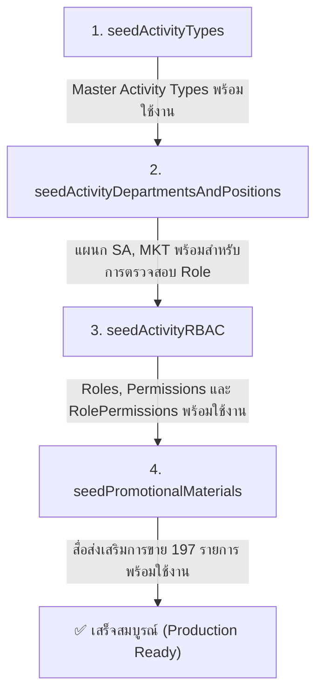

# Activity Seed

## 1. วัตถุประสงค์

โฟลเดอร์นี้รวบรวม Seed สำหรับเตรียมข้อมูลพื้นฐานที่เกี่ยวข้องกับระบบ **Activity (Trip Plan & Field Execution)** ของ CS ONE CRM โดยเป็นชุดข้อมูลหลักระดับ **Master Data (Production-Ready)** ที่ตัดข้อมูลทดสอบ (Mock Data) ออกทั้งหมดแล้ว

วัตถุประสงค์หลัก:

- รวม Seed ที่เกี่ยวข้องกับ Activity ไว้ในตำแหน่งเดียวกันอย่างเป็นระบบ
- แยกหน้าที่ของ Seed แต่ละชุดให้ชัดเจนตามหลัก Modular Architecture
- กำหนดลำดับการทำงานให้สอดคล้องกับความสัมพันธ์ของข้อมูล (Data Dependencies)
- ป้องกันข้อมูลซ้ำซ้อนผ่านคำสั่ง Idempotent Upsert
- ทำให้โครงสร้าง Role, Permission, Types และ Master Data มี **Single Source of Truth** ในระดับโค้ด สามารถตรวจสอบย้อนกลับผ่าน Git Version Control ได้

---

## 2. โครงสร้างไฟล์

```text
prisma/seed/activity/
├── README.md                  # เอกสารกำกับการทำงานของชุด Seed (ไฟล์นี้)
├── activity-rbac.ts           # Master Seed สำหรับสิทธิ์ (Permissions) และบทบาท (9 Roles)
├── activity-types.ts          # Master Seed ประเภทงานกิจกรรม 15 Types (Type 1 - Type 14)
├── departments-positions.ts   # Master Seed แผนก (SA, MKT) และตำแหน่งงานสายกิจกรรม
├── index.ts                   # Entry Point ประสานการรัน Master Seed ทั้งหมด
└── promotional-materials.ts   # Master Seed แคตตาล็อกสื่อส่งเสริมการขายและของแถม (197 รายการ)
```

### หน้าที่ของแต่ละไฟล์

| ไฟล์                       | หน้าที่หลัก                                                                                 | ตารางที่เกี่ยวข้อง                     |
| -------------------------- | ------------------------------------------------------------------------------------------- | -------------------------------------- |
| `activity-types.ts`        | Seed ข้อมูลประเภทกิจกรรม 15 Types ที่ระบบใช้อ้างอิงในแบบฟอร์มและการจัดเก็บ Dedicated Tables | `activity_types`                       |
| `departments-positions.ts` | Seed แผนกบริหารงานขาย (SA), แผนกการตลาด (MKT) และตำแหน่งงาน 7 ตำแหน่งสำหรับ Approval Line   | `Department`, `Position`               |
| `activity-rbac.ts`         | Seed สิทธิ์การเข้าถึง 22 รายการ และ 9 บทบาทเฉพาะทางของ Activity พร้อม Matrix สิทธิ์         | `Permission`, `Role`, `RolePermission` |
| `promotional-materials.ts` | Seed แคตตาล็อกสื่อส่งเสริมการขาย 197 รายการ สำหรับใช้เบิกในกิจกรรมภาคสนาม                   | `promotional_materials`                |
| `index.ts`                 | จุดศูนย์กลาง (Orchestrator) เรียกใช้ Seed ทุกตัวตามลำดับ พร้อมจัดการ Connection             | รวมทุกตารางข้างต้น                     |

---

## 3. รายละเอียด Seed แต่ละไฟล์

### 3.1 `activity-rbac.ts`

**วัตถุประสงค์**
จัดเตรียมข้อมูลสิทธิ์การใช้งาน (Permissions) และบทบาทผู้ใช้งาน (Roles) สำหรับโมดูล Activity Plan เพื่อแยกสิทธิ์ของกิจกรรมและกระบวนการอนุมัติออกจากระบบงานขายทั่วไป ตามเอกสารสถาปัตยกรรม [`docs/activity/ACTIVITY-RBAC-PERMISSIONS.md`](../../docs/activity/ACTIVITY-RBAC-PERMISSIONS.md)

**รายละเอียดข้อมูล**

- **Permissions (22 รายการ)**:
  - _การจัดการแผนงาน_: `activity_plan.view`, `activity_plan.create`, `activity_plan.edit`, `activity_plan.submit`, `activity_plan.view_own`, `activity_plan.view_pending`
  - _การอนุมัติตามสายงาน_: `activity_plan.approve`, `activity_plan.reject`, `activity_plan.request_correction`
  - _การอนุมัติงบประมาณ_: `activity_plan.approve_sales_promotion_budget`, `activity_plan.approve_marketing_budget`, `activity_plan.approve_total_budget`
  - _การตรวจสอบผู้ช่วยงาน_: `activity_plan.review_sales_helper`, `activity_plan.review_marketing_helper`
  - _ปฏิทินและบันทึกผล_: `activity_plan.view_calendar`, `activity_plan.record_actual`, `activity_plan.edit_actual`
  - _เมนูและขอบเขตข้อมูล_: `menu.activity_plans`, `data.activity_plans`
  - _สื่อส่งเสริมการขาย_: `menu.promotional_materials`, `promotional_material.view`, `promotional_material.create`, `promotional_material.edit`, `promotional_material.delete`, `data.promotional_materials`
- **Roles (9 บทบาท)**:
  1. `activity_promoter`: พนักงานส่งเสริมการขาย-กิจกรรม (`VIEW_OWN`)
  2. `activity_sales_employee`: พนักงานขาย-กิจกรรม (`VIEW_TEAM`)
  3. `activity_area_manager`: ผู้จัดการภาค-กิจกรรม (`VIEW_TEAM`)
  4. `activity_district_manager`: ผู้จัดการเขต-กิจกรรม (`VIEW_TEAM`)
  5. `activity_sales_admin_manager`: ผู้จัดการแผนกบริหารงานขาย-กิจกรรม (`VIEW_ALL`, อนุมัติงบ SP)
  6. `activity_marketing_manager`: ผู้จัดการแผนกการตลาด-กิจกรรม (`VIEW_ALL`, อนุมัติงบ MKT)
  7. `activity_sales_director`: ผู้จัดการฝ่ายขาย-กิจกรรม (`VIEW_ALL`, อนุมัติงบรวมทั้งหมด)
  8. `activity_marketing_employee`: พนักงานการตลาด-กิจกรรม (`VIEW_OWN`)
  9. `activity_marketing_admin`: แอดมินการตลาด-กิจกรรม (`VIEW_ALL` สื่อส่งเสริมการขาย)
- **ตารางฐานข้อมูล**: `Permission`, `Role`, `RolePermission`
- **Unique Key**:
  - `Permission`: `key`
  - `Role`: `slug`
  - `RolePermission`: `roleId_permissionId` (Composite Unique)

**พฤติกรรมการทำงาน (Idempotency & Overwrite Rule)**

- ตรวจสอบ `Permission.key` และ `Role.slug` หากยังไม่มีจะทำการ `create` หากมีแล้วแต่ชื่อ/คำอธิบายเปลี่ยนจะทำการ `update`
- สำหรับ `RolePermission`: หากยังไม่มีการจับคู่จะทำการ `create` แต่หากมีอยู่แล้ว **จะทำการ Overwrite ค่า `dataAccess`, `editAccess`, `deleteAccess`, และ `allow` ให้ตรงกับไฟล์ Seed เสมอ**
- ไม่มีการลบ RolePermission อื่นที่อยู่นอกเหนือจากไฟล์ seed (Safe Add/Update)

---

### 3.2 `activity-types.ts`

**วัตถุประสงค์**
จัดเตรียม Master Data ของประเภทงานกิจกรรมทั้งหมด 15 ประเภทงาน (Type 1 – Type 14) ตามมาตรฐาน Vertical Slice Architecture

**รายละเอียดข้อมูล**

- **15 ประเภทงาน**:
  - `TYPE_1`: เข้าพบร้านค้า / Key Farmer (`shortName: Visit`)
  - `TYPE_2`: ติดตามผลการใช้สินค้า (`shortName: Followup`)
  - `TYPE_3`: เสนอขายสินค้า (`shortName: Sales`)
  - `TYPE_4`: วางบิล / เก็บเงิน (`shortName: Collect`)
  - `TYPE_5`: สำรวจตลาดของคู่แข่ง (`shortName: Survey`)
  - `TYPE_6`: ตรวจสอบเรื่องร้องเรียน / แก้ปัญหา (`shortName: Issue`)
  - `TYPE_7A`: ทำแปลงสาธิต (`shortName: DemoNew`)
  - `TYPE_7B`: ติดตามแปลงสาธิต (`shortName: DemoFollow`)
  - `TYPE_8`: จัดประชุม (`shortName: Meeting`)
  - `TYPE_9`: จัดกิจกรรมส่งเสริมการขายหน้าร้าน (`shortName: Store`)
  - `TYPE_10`: จัดงาน Field Day (`shortName: FieldDay`)
  - `TYPE_11`: ตรวจเช็คสต๊อกหน้าร้าน (`shortName: Stock`)
  - `TYPE_12`: ทัวร์ (`shortName: Tour`)
  - `TYPE_13`: ฉีดแปลงแฮตแทค (`shortName: HattackSpray`)
  - `TYPE_14`: ติดตามแปลงแฮตแทค (`shortName: HattackFollow`)
- **ตารางฐานข้อมูล**: `activity_types` (Model: `ActivityType`)
- **Unique Key**: `code`
- **พฤติกรรมการทำงาน**: ใช้ `prisma.activityType.upsert` โดยค้นหาจาก `code` หากมีอยู่แล้วจะอัปเดต `name`, `shortName`, `sortOrder`, `hasActual`, `requiresApproval`, และ `isActive = true`

---

### 3.3 `departments-positions.ts`

**วัตถุประสงค์**
จัดเตรียมโครงสร้างแผนกและตำแหน่งงานที่จำเป็นต่อสายการบังคับบัญชาและการอนุมัติแผนงานกิจกรรม (Line Approval Workflow)

**รายละเอียดข้อมูล**

- **แผนก (2 แผนก)**:
  - `SA`: แผนกบริหารงานขาย
  - `MKT`: แผนกการตลาด
- **ตำแหน่งงาน (7 ตำแหน่ง)**:
  - `พนักงานส่งเสริมการขาย` (Level 1, Non-Manager, ผูกกับแผนก SA)
  - `พนักงานขาย` (Level 1, Non-Manager, ผูกกับแผนก SA)
  - `ผู้จัดการภาค` (Level 2, Managerial, ผูกกับแผนก SA)
  - `ผู้จัดการแผนกบริหารงานขาย` (Level 3, Managerial, ผูกกับแผนก SA)
  - `พนักงานการตลาด` (Level 1, Non-Manager, ผูกกับแผนก MKT)
  - `ผู้จัดการแผนกการตลาด` (Level 3, Managerial, ผูกกับแผนก MKT)
  - `ผู้จัดการฝ่ายขาย` (Level 4, Managerial, ผูกกับแผนก SA)
- **ตารางฐานข้อมูล**: `Department`, `Position`
- **Unique Key**:
  - `Department`: `code` (`upsert`)
  - `Position`: ค้นหาด้วย `name` หากไม่พบจะ `create`
- **การนำไปใช้งานต่อ**: นำไปใช้อ้างอิงใน `Employee.departmentId`, `Employee.positionId` และฟังก์ชันคำนวณผู้มีสิทธิ์อนุมัติใน `modules/activity/domain/approval/operator-resolver.ts`

---

### 3.4 `index.ts`

**วัตถุประสงค์**
ทำหน้าที่เป็น Entry Point กลางสำหรับรัน Seed ข้อมูล Master Data ของ Activity ทั้งหมดในครั้งเดียว

**รายละเอียดการทำงาน**

- นำเข้าฟังก์ชัน Seed ทั้ง 4 ตัว:
  1. `seedActivityTypes`
  2. `seedActivityDepartmentsAndPositions`
  3. `seedActivityRBAC`
  4. `seedPromotionalMaterials`
- จัดการสร้างการเชื่อมต่อผ่าน `@prisma/adapter-pg` ร่วมกับ `DATABASE_URL`
- มี Error Handling พร้อมตัดการเชื่อมต่อ `prisma.$disconnect()` เมื่อเสร็จสิ้นหรือเกิดข้อผิดพลาด
- รองรับการรันเดี่ยวผ่าน Command Line (`process.argv[1]?.includes("activity")`)
- ส่งออกทั้ง `seedActivityMasterData` และ Alias `seedActivityTestData` เพื่อความเข้ากันได้ย้อนหลัง (Backward Compatibility)

---

### 3.5 `promotional-materials.ts`

**วัตถุประสงค์**
จัดเตรียม Master Data ของแคตตาล็อกสื่อส่งเสริมการขาย ของแจก และอุปกรณ์จัดงานกิจกรรมภาคสนามจำนวน 197 รายการ

**รายละเอียดข้อมูล**

- **หมวดหมู่หลัก (5 Categories)**:
  - `Premium_item`: ของพรีเมียม (เสื้อ, หมวก, ร่ม, ถุงผ้า, แก้วน้ำ ฯลฯ)
  - `PP_Board`: ป้ายฟิวเจอร์บอร์ดสินค้าและโรคพืชขนาดต่าง ๆ
  - `Banner`: ป้ายไวนิลและแบนเนอร์ประชาสัมพันธ์
  - `Leaflet`: แผ่นพับและเอกสารวิชาการ
  - `อุปกรณ์จัดงาน`: เต็นท์, โต๊ะ, เก้าอี้, หญ้าเทียม, สแตนดี้
- **ตารางฐานข้อมูล**: `promotional_materials` (Model: `PromotionalMaterial`)
- **Unique Key**: `sku`
- **พฤติกรรมการทำงาน**: ใช้ `prisma.promotionalMaterial.upsert` โดยค้นหาจาก `sku` หากมีอยู่แล้วจะอัปเดต `name`, `category`, `unit`, `price`, `quantity`, และ `status: "ACTIVE"`
- **การนำไปใช้งานต่อ**: ใช้ในหน้าจอสร้างแผนงาน (Trip Plan Budget Section), ระบบบันทึกผลเบิกจ่ายสื่อ และหน้ารายการจัดการสื่อ `/activity-plans/promotional-materials`

---

## 4. ลำดับการทำงาน (Execution Order)

ใน `index.ts` ได้จัดลำดับการรัน Seed ตาม Dependency ของตารางฐานข้อมูลดังนี้:



**เหตุผลของลำดับ:**

1. **`ActivityType` มาก่อน**: เป็น Master Data พื้นฐานระดับระบบ ไม่มี Foreign Key พึ่งพาตารางอื่น
2. **`Department & Position`**: ต้องสร้าง Department ให้เสร็จก่อนเพื่อนำ `id` มาผูกกับ `Position.departmentId`
3. **`Activity RBAC`**: ต้องสร้าง `Permission` และ `Role` ก่อน จึงจะสร้างความสัมพันธ์ลงตารางคู่ `RolePermission` ได้
4. **`Promotional Materials`**: เป็นตาราง Master อิสระที่อ้างอิง `sku` ไม่ขึ้นกับตารางอื่น สามารถรันปิดท้ายได้อย่างปลอดภัย

---

## 5. ความสัมพันธ์กับฐานข้อมูล

| Prisma Model          | Database Table          | Unique Key               | Create Behavior          | Update Behavior                                                   | Dependencies         | Downstream Usage                                          |
| --------------------- | ----------------------- | ------------------------ | ------------------------ | ----------------------------------------------------------------- | -------------------- | --------------------------------------------------------- |
| `ActivityType`        | `activity_types`        | `code`                   | `upsert.create`          | อัปเดต name, shortName, sortOrder, flags                          | ไม่มี                | ฟอร์มสร้างแผนงาน, `ActivityPlan.activityTypeId`           |
| `Department`          | `Department`            | `code`                   | `upsert.create`          | ไม่มี (คงค่าเดิม)                                                 | ไม่มี                | `Employee`, `Position`                                    |
| `Position`            | `Position`              | `name`                   | `findFirst` -> `create`  | ไม่เขียนทับหากมีอยู่แล้ว                                          | `Department`         | `Employee.positionId`, Workflow Operator Resolver         |
| `Permission`          | `Permission`            | `key`                    | `findUnique` -> `create` | อัปเดต name, description, category, resource, menuPath            | ไม่มี                | RBAC Guard, Auth Session, UI Action Buttons               |
| `Role`                | `Role`                  | `slug`                   | `findUnique` -> `create` | อัปเดต name, description, isActive                                | ไม่มี                | `UserRole`, Role Matrix Management                        |
| `RolePermission`      | `RolePermission`        | `[roleId, permissionId]` | `findUnique` -> `create` | **Overwrite** `dataAccess`, `editAccess`, `deleteAccess`, `allow` | `Role`, `Permission` | การคำนวณ Data Scope (`VIEW_OWN`, `VIEW_TEAM`, `VIEW_ALL`) |
| `PromotionalMaterial` | `promotional_materials` | `sku`                    | `upsert.create`          | อัปเดต name, category, unit, price, quantity, status              | ไม่มี                | หน้างบประมาณแผนงาน, หน้าจัดการสื่อส่งเสริมการขาย          |

---

## 6. วิธีเรียกใช้งาน

### 6.1 รัน Master Seed ของ Activity ทั้งหมด (แนะนำ)

ใช้คำสั่งผ่าน Script ที่ตั้งไว้ใน `package.json`:

```bash
# รันผ่าน npm
npm run seed:activity

# หรือรันผ่าน pnpm
pnpm seed:activity

# หรือรันผ่าน tsx โดยตรง
npx tsx prisma/seed/activity/index.ts
```

### 6.2 รันเฉพาะไฟล์ที่ต้องการอัปเดตเดี่ยว ๆ

สามารถรันไฟล์เฉพาะจุดเพื่ออัปเดตข้อมูลบางส่วนได้:

```bash
# อัปเดตเฉพาะสิทธิ์และบทบาท RBAC
npx tsx prisma/seed/activity/activity-rbac.ts
```

### 6.3 การเชื่อมโยงกับ Core System Seed

ไฟล์ `prisma/seed/core/index.ts` มีการดึง `seedPromotionalMaterials` ไปทำงานร่วมกับ Core Master Data อยู่แล้ว ดังนั้นเมื่อรัน `npm run seed` หรือ `npm run seed:core` สื่อส่งเสริมการขายจะถูก Seed ด้วยโดยอัตโนมัติ

---

## 7. หลักการป้องกันข้อมูลซ้ำและการอัปเดตข้อมูล

1. **Idempotent by Design**: ชุด Seed ทั้งหมดสามารถรันซ้ำกี่ครั้งก็ได้ โดยไม่เกิด Record ซ้ำซ้อน (No Duplicate Rows)
2. **Deterministic Unique Keys**: ใช้ฟิลด์คงที่ทางธุรกิจเป็นตัวระบุเสมอ เช่น `code`, `slug`, `key`, `sku` หลีกเลี่ยงการใช้ Auto-generated ID หรือ CUID ในการค้นหา
3. **Overwrite Policy สำหรับ RBAC**:
   - เพื่อให้โค้ดเป็น Single Source of Truth สิทธิ์ `RolePermission` ในไฟล์ `activity-rbac.ts` จะเขียนทับค่าเดิมในฐานข้อมูลเสมอ
   - หากต้องการเปลี่ยนขอบเขตสิทธิ์ (เช่น เปลี่ยนจาก `VIEW_TEAM` เป็น `VIEW_ALL`) **ต้องแก้ที่ไฟล์ `activity-rbac.ts` ก่อนเสมอ** ห้ามแก้ตรงใน Database หรือหน้า UI เพียงอย่างเดียวเพราะจะถูก Seed เขียนทับเมื่อมีการ Deploy
4. **Preserve User Data**: ไม่มีการใช้คำสั่ง `deleteMany` หรือล้างตารางทิ้ง ทำให้ข้อมูลแผนงานจริง (Transaction Data) ของผู้ใช้งานใน Production ปลอดภัย 100%

---

## 8. แนวทางเมื่อเพิ่มหรือแก้ไข Seed

เมื่อมีประเภทงานใหม่, ตำแหน่งใหม่ หรือสิทธิ์ใหม่ในระบบ:

1. **ตรวจสอบ Schema**: ตรวจสอบว่าใน `prisma/schema.prisma` มีฟิลด์หรือ Enum รองรับครบถ้วน
2. **แก้ไขไฟล์ Seed เฉพาะจุด**:
   - เพิ่มประเภทงาน -> แก้ไข `activity-types.ts`
   - เพิ่ม/ปรับสิทธิ์การเข้าถึง -> แก้ไข `activity-rbac.ts`
   - เพิ่มของพรีเมียม/สื่อใหม่ -> แก้ไข `promotional-materials.ts`
3. **ทดสอบรันในเครื่อง Local**:
   ```bash
   npm run seed:activity
   ```
4. **ตรวจสอบความถูกต้องด้วย TypeScript**:
   ```bash
   npx tsc --noEmit
   ```
5. **อัปเดตเอกสาร**: ปรับปรุงตารางและคำอธิบายใน `README.md` ฉบับนี้และ [`docs/activity/ACTIVITY-RBAC-PERMISSIONS.md`](../../docs/activity/ACTIVITY-RBAC-PERMISSIONS.md) ให้ตรงกับโค้ดจริงเสมอ

---

## 9. ข้อควรระวัง

1. **ห้ามใช้ `prisma migrate reset` บน Production**: คำสั่งนี้จะล้างฐานข้อมูลทิ้งทั้งหมด ให้ใช้คำสั่ง `prisma migrate deploy` แล้วตามด้วย `npm run seed:activity` เท่านั้น
2. **ความตระหนักเรื่องสิทธิ์ถูก Overwrite**: หากผู้ดูแลระบบเคยไปปรับแก้สิทธิ์ผ่านหน้าเว็บ UI สิทธิ์เหล่านั้นจะถูกแทนที่ด้วยค่าใน `activity-rbac.ts` เมื่อรัน Seed ใหม่
3. **การเปลี่ยน SKU หรือ Code**: หากเปลี่ยนค่าที่เป็น Unique Key (เช่น เปลี่ยน SKU ของสื่อ หรือเปลี่ยน Code ของประเภทงาน) จะทำให้ระบบมองเป็นรายการใหม่และสร้าง Row เพิ่มขึ้นแทนที่จะเป็นการอัปเดตของเดิม

---

## 10. การดูแลเอกสาร

เมื่อโค้ดในโฟลเดอร์นี้มีการเปลี่ยนแปลง (เช่น เพิ่ม Role, เพิ่มประเภทกิจกรรม หรือเปลี่ยนเงื่อนไขการ Upsert) ผู้พัฒนาต้องตรวจสอบย้อนกลับไปยัง:

1. `prisma/schema.prisma`
2. ฟังก์ชันในแต่ละไฟล์ Seed
3. ปรับปรุงตารางในหัวข้อที่ 2, 3 และ 5 ของ `README.md` ฉบับนี้ให้สอดคล้องกับพฤติกรรมจริงของระบบล่าสุดเสมอ
